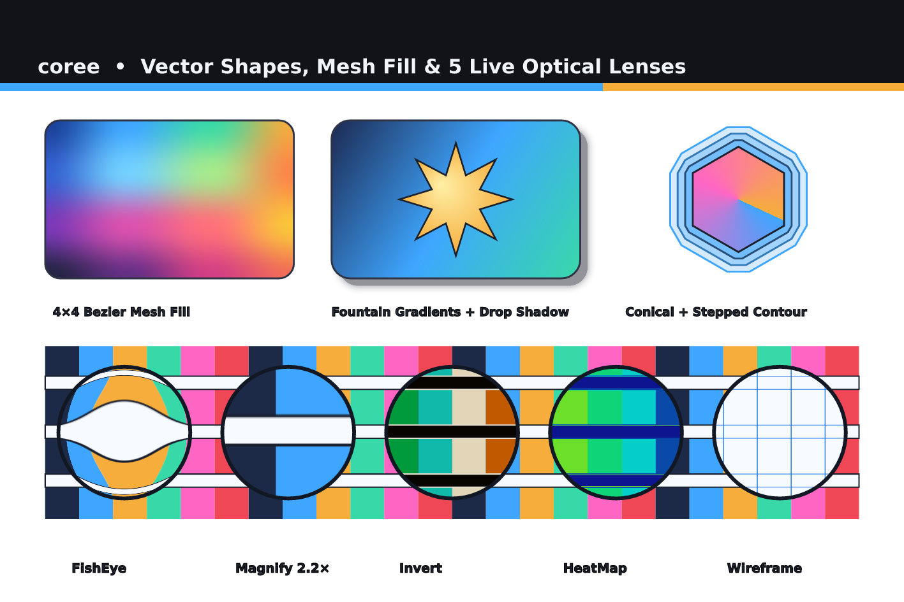
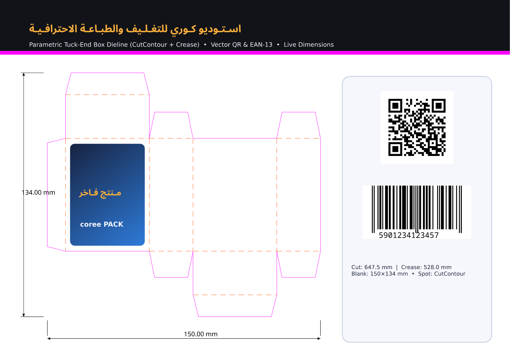
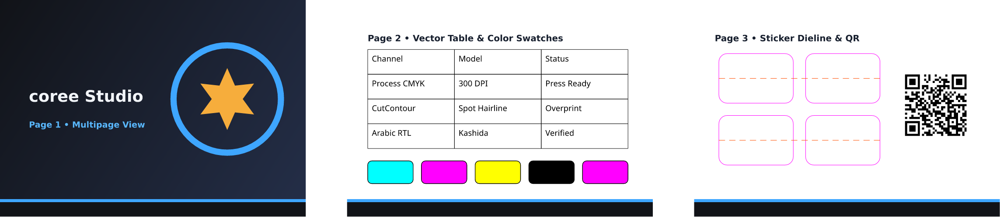

# coree

**Clean-Room Open-Source Vector Graphics, Multipage Layout, Laser Production & Print Studio — Linux-First, Cross-Platform, 100% Offline**

**كورِي (`coree`) — حزمة رسوميات متجهية وتخطيط صفحات وإنتاج طباعي وقص بالليزر مفتوحة المصدر ومبنية بالكامل من الصفر — لينكس أولاً، تعمل محلياً دون اتصال بالإنترنت**

[](https://github.com/ahrrfy/coree/actions/workflows/ci.yml)
[](LICENSE-MIT)
[![Rust: #![forbid(unsafe_code)]](https://img.shields.io/badge/Rust-forbid(unsafe__code)-f6ad3c.svg)](SECURITY.md)

---

## Visual Showcase / معرض المخرجات الفعلية

All images below are rendered directly by `coree render` (verified 100.0% pixel-deterministic):

| Live Optical Lenses & Mesh Fill | Arabic RTL/Kashida + Parametric Dieline + QR/EAN-13 | Multipage View |
| :---: | :---: | :---: |
|  |  |  |

---

## English Overview

`coree` is a clean-room, open-source desktop vector illustration, multipage layout, integrated raster studio, vector tracing, laser/engraving plugin, and commercial print-production suite written in pure Rust and dual-licensed under **`MIT OR Apache-2.0`**. Built for print shops, laser cutting & fiber engraving workshops, sign makers, packaging/vinyl studios, Arabic/MENA & international designers on **Linux** and **Windows**, `coree` runs **100% offline** with **zero subscriptions, zero accounts, zero cloud lock-in, and zero telemetry**.

- **Repository:** [https://github.com/ahrrfy/coree](https://github.com/ahrrfy/coree)
- **License:** Dual-licensed under [MIT](LICENSE-MIT) or [Apache-2.0](LICENSE-APACHE) (Rust ecosystem gold standard: MIT's maximum global adoption + Apache-2.0's explicit patent grant & trademark non-grant; see [NOTICE](NOTICE))
- **Feature Parity:** **100.0 / 100** (`68/68` must-have capabilities complete across all 13 feature areas — see [replica/parity.md](replica/parity.md))
- **Verified Quality:** `#![forbid(unsafe_code)]` across all 7 crates, **323/323** automated unit/integration/E2E/adversarial tests passing (`0` open S1/S2 bugs across 105 verified audit fixes), `cargo clippy --workspace --all-targets -- -D warnings` clean, **35/35** WCAG 2.2 AA/AAA contrast pairs passing, and **100.0%** deterministic pixel-identical rendering verified via `imgdiff.py`.

---

### What's New in `v0.3.0` (Including `v0.2.x` Engine Upgrades)

- **Print Export Fidelity & Custom ICC Profiles (`coree-io`, `coree-core`, `coree-render`):** Vector glyph curves via `TextEngine` (`cosmic-text` + `swash`) eliminate non-WinAnsi/Arabic Tofu boxes in **PDF** and **EPS** exports; PDF export adds ISO 32000-1 `/Separation` Spot plates (`CutContour`), `/ShadingType 2/3` axial/radial gradients, `/OutputIntents` ICC embedding, custom `.icc`/`.icm` profile loading with live canvas soft-proofing, and cross-page **`Desktop` layer** output.
- **Native OS Printing (`Ctrl+P`) & Dual Windows CLI/GUI Launcher (`coree-app`):** Built-in CUPS (`lpstat`/`lp`/`lpr`) and Windows Print Spooler (`Get-Printer`/`Start-Process`) job submission; pure-Rust Single-Instance TCP loopback IPC (`--new-window`); and paired Windows Console-subsystem **`coree.com`** beside GUI **`coree.exe`** so PowerShell/CI automation gets synchronous exit codes and UTF-8 Arabic console output without flashing CMD popups.
- **Classic Interactive Editing, Effects Lowering & Bilingual Arabic UI (`coree-core`, `coree-app`, `coree-render`):** Modal **Edit Fill (`F11`)** and **Outline Pen (`F12`)** dialogs; interactive Linear/Radial/Conical/Square gradient stop & focal handle dragging; `Ctrl+K` (*Break Apart*) decomposition of Shadows/Contours/2.5D Extrudes/Blends/Symmetry via `lower_effects_to_primitives`; **`PowerClip` `lock_contents`**; numeric `font_weight` (`100..900`) + OpenType (`liga`/`calt`/`kern`) + `bidi_font_family`; HiDPI canvas scaling; **Rayon parallel dirty-tile rendering** + `OnceLock` shared font DB; v2 `.coreews` Dock/Shortcut persistence + Custom Shortcut Editor (`Ctrl+J`); and live bilingual **English / العربية** (`EN | ع`) UI with `unicode-bidi` shaping.
- **Authentic `.cdr` Across Generations (`coree-cdr`):** Direct ZCF X6–2025 (`v16–26`) indirect pointer dereferencing, `[0..1]` vs local-mm gradient rescaling, cycle-guarded `styles/document.cdss` inheritance + RTL/numeric font weights, RIFF `arrw`/`bmpf`/`vpat`/`clrs` resource handlers, legacy `v7–v15` `fild`/`outl` fallbacks, CP1256 Arabic decoding, and embedded preview PNG extraction.
- **Pro Importers, Laser Plugins & 65 Live Tools (`coree-io`, `coree-prod`, `coree-storage`):** Native **PDF/AI**, **EPS**, **DXF/PLT**, and streaming multi-layer **PSD/PSB** importers; **7 built-in Laser/Plotter Plugins** (**LightBurn**, **RDWorks**, **EZCad**, **LaserDRW**, **LaserGRBL**, **InkCut**, **HPGL Plotter**) + JSON/TOML/Rhai plugins; 65 interactive tools across 15 flyout groups + 6 Workspaces; and Unix owner-only `0700`/`0600` hardening on local SQLite WAL & autosave directories/files.

---

### Architecture (7-Crate Pure-Rust Workspace)

| Crate | Purpose |
| --- | --- |
| [`crates/coree-core`](crates/coree-core) | Scene graph, 8 physical units (`mm`..`CdrTenthMicron`), 6 color models, pure-Rust **ICC v2/v4** engine (`sRGB`/`DisplayP3`/`ISO Coated v2`/`SWOP`), 10 analytic **PostScript fills**, 8 parametric shapes, 9 `i_overlay` Boolean ops, all 11 Lenses, 10 live vector effects, 19 raster filters, Arabic RTL/Kashida model, `VectorTable`, Dimensions/Connectors, **Autofit Page**, R-Tree `SpatialIndex`, 28 serializable `CommandOp`s, transactional undo/redo |
| [`crates/coree-cdr`](crates/coree-cdr) | Clean-room `.cdr` (RIFF v4–v13, ZIP/OPC X4–X5, **ZCF X6–2025 v16–26** indirect pointer dereferencing, `document.cdss`, `docPalette.xml`), `.cdt`, `.cmx` (16/32-bit RIFF & RIFX), and `.cpt` codecs, byte-exact **Unknown-Chunk Passthrough**, **CP1256** legacy Arabic decoder, **Embedded Thumbnail Extractor**, **CDR Inspector**, and Zip-Bomb/Zip-Slip/amplification hardening |
| [`crates/coree-io`](crates/coree-io) | Native `.coree` archive, **PDF 1.0–2.0 / `.ai`** import + DeviceCMYK/RGB PDF 1.7 print-marks export, **EPS** import & export, **DXF (R12/R2000+)** & **HPGL `.plt`** import & export, streaming multi-layer **PSD/PSB** import, SVG/SVGZ import & export, PNG/JPEG/WebP/TIFF/BMP + PNG `pHYs` DPI, palette `.gpl`/`.ase`/`.pal` I/O, atomic `fsync` saves |
| [`crates/coree-storage`](crates/coree-storage) | Bundled SQLite 3 (WAL mode, 10-table schema), SHA-256 autosave snapshots, deterministic `command_journal` crash recovery, recents/palettes/templates/layouts/preferences, local SFNT font scanner (Arabic/Kashida detection), non-blocking Rayon background job pool |
| [`crates/coree-render`](crates/coree-render) | Backend-agnostic `CanvasBackend` (`tiny-skia`), Rayon 256×256 `DirtyTileCache`, live **ICC Soft-Proofing & Gamut Warning**, `cosmic-text` Arabic RTL/BiDi/Kashida shaping + **Glyphs Catalog API** + real glyph curves, all 11 live optical Lenses, all 10 vector effects, 10 SDF PostScript fills, Raster Studio (Paint/Eraser/Clone/Smudge/**Healing**/**Dodge/Burn**/**Flood Fill**/masks/19 filters/cutout/resample), 3-mode Vector Trace, Smart Fill, hit-testing & snapping |
| [`crates/coree-prod`](crates/coree-prod) | **Laser Cutting, Engraving & Plotter Engine** (dedupe, join, kerf, hatch, inner-first ordering, travel optimization, weeding box, GRBL/Marlin/Ruida G-Code & DXF/PLT/SVG/EPS) + **7 Built-in Laser/Plotter Plugins** (`LightBurn`, `RDWorks`, `EZCad`, `LaserDRW`, `LaserGRBL`, `InkCut/VisiCut`, `HPGL Plotter`) + custom JSON/TOML/Rhai plugins, CMYK/Spot separations & overprint, N-Up/Booklet/Tiling imposition, Print Marks, Preflight, Collect for Output, `CutContour`, 4 Parametric Dielines, Path Meter, QR & 1D Barcodes, bilingual CSV Print Merge, CIE76 Find & Replace, sandboxed Rhai macros |
| [`crates/coree-app`](crates/coree-app) | Native cross-platform desktop UI (`eframe 0.37` / `egui 0.37` / `egui_dock 0.22`, pure-Rust `rfd` XDG Portal), **62 real interactive tools** in 15 Toolbox flyout groups, 6 Studio Workspace Presets, Glyphs Docker, Laser & Plugins Docker, right-click context menu, full muscle-memory shortcuts, WCAG AA Dark/Light/HighContrast themes, native window icon & Win32 `build.rs` resources, and 11-subcommand headless CLI (`coree`) |

---

### Installation & Packaging

#### Option 1 — Linux: Prebuilt Packages (GitHub Releases)
Download the latest release assets from [GitHub Releases](https://github.com/ahrrfy/coree/releases):

- **Ubuntu / Debian (`.deb` — Recommended for Debian/Ubuntu/Mint/Pop!_OS):**
  ```bash
  sudo apt install ./coree_0.3.0_amd64.deb
  ```
  Installs `/usr/bin/coree`, desktop entry, canonical `application/vnd.corel-draw` MIME rules (eliminates ZIP icons on `.cdr` files!), SVG app & MIME icons, GNOME/freedesktop `coree.thumbnailer`, and AppStream metainfo.
- **Universal Portable `.AppImage` (Any Linux distro, zero install):**
  ```bash
  chmod +x coree-v0.3.0-x86_64.AppImage
  ./coree-v0.3.0-x86_64.AppImage
  ```
- **Offline-Sandboxed Flatpak:**
  Build locally from [packaging/linux/flatpak/io.github.ahrrfy.coree.yml](packaging/linux/flatpak/io.github.ahrrfy.coree.yml) (strictly sandboxed with Wayland/X11/DRI and **no network access**):
  ```bash
  flatpak-builder --user --install --force-clean build-dir packaging/linux/flatpak/io.github.ahrrfy.coree.yml
  flatpak run io.github.ahrrfy.coree
  ```

#### Option 2 — Linux: Build from Source & Zero-Sudo Local Install
`coree` dynamically loads Wayland/X11/OpenGL runtime libraries, bundles SQLite, and uses pure-Rust XDG Desktop Portals (`rfd`) — **no `-dev` C header packages (`libgtk-3-dev`, `libx11-dev`, `libfontconfig-dev`) are required**; only Rust stable ([rustup.rs](https://rustup.rs)) and `gcc` (`build-essential`).

```bash
git clone https://github.com/ahrrfy/coree.git
cd coree

# Builds release binary & installs ~/.local/bin/coree, app + MIME icons,
# desktop entry, canonical .cdr MIME rules, GNOME thumbnailer & xdg-mime defaults (no sudo)
./packaging/linux/install-linux.sh

# Verify local installation
~/.local/bin/coree --diagnostics
```

Build native `.deb` or `.AppImage` locally without `sudo`:
```bash
./packaging/linux/build-deb.sh
./packaging/linux/build-appimage.sh
```

#### Option 3 — Windows (`x86_64`): MSI Installer or Portable ZIP
Download from [GitHub Releases](https://github.com/ahrrfy/coree/releases):
- **Windows Installer (`.msi`):** Double-click `coree-v0.3.0-x86_64-windows-setup.msi` — installs GUI `coree.exe` (with embedded `coree.ico`, `PerMonitorV2` HiDPI & `UTF-8` Arabic filename manifest) and CLI companion **`coree.com`**, Start Menu & Desktop shortcuts, `PATH` entry, and full Windows Registry file associations (`coree.Document` + `OpenWithProgids` for `.coree`, `.cdr`, `.cdt`, `.cmx`, `.cpt`, `.svg`, `.pdf`, `.eps`, `.dxf`, `.plt`, `.psd`).
- **Portable `.zip` (Zero Admin):** Extract `coree-v0.3.0-x86_64-windows-portable.zip` anywhere and run `coree.exe` (or `coree.com` from PowerShell/CMD for synchronous CLI output). Optionally double-click `register-file-associations.cmd` to register `.coree`/`.cdr`/`.cdt`/`.cmx`/`.cpt`/`.svg`/`.dxf`/`.plt` in `HKCU` without Administrator privileges!

To build from source on Windows (MSVC, MinGW-w64, or WiX v4 `.msi`), see [packaging/windows/build-windows.md](packaging/windows/build-windows.md).

---

### Headless CLI Reference

Launching `coree` with no subcommand opens the native desktop studio GUI (optionally passing files to open directly as tabs: `coree artwork.cdr layout.coree`). All production pipelines are also available offline via CLI:

```bash
# Print build version, license, supported formats, plugin count, and indexed local fonts
coree --diagnostics

# Generate a rich showcase sample (.coree, cdr-riff, cdr-x4, cdr-x6, cdt, cmx, svg)
coree generate-sample demo.cdr --format cdr-x6

# Inspect .cdr/.cdr.zip/.cdt/.cmx/.cpt/.coree/.svg/.pdf/.ai/.eps/.dxf/.plt/.psd structure
coree inspect demo.cdr --json

# Universal offline converter (.coree, .cdr, .cdt, .cmx, .svg, .pdf, .ai, .eps, .dxf, .plt, .psd, .gcode, rasters)
coree convert demo.cdr press_ready.pdf --cmyk --crop-marks
coree convert brochure.pdf editable.coree
coree convert design.psd preview.png --dpi 300

# Deterministic headless renderer (single page or side-by-side Multipage View)
coree render demo.coree page0.png --page 0 --dpi 150 --view enhanced
coree render brochure.coree spread.png --multipage --dpi 120

# Fast OS thumbnail extractor (uses embedded CDR/coree previews or renders Page 0)
coree thumbnail artwork.cdr preview.png --size 256

# Laser Cutting, Engraving & Plotter toolpath export (GRBL/Marlin/Ruida G-Code, DXF R12, PLT, SVG, EPS)
coree laser sign.cdr cut_job.gcode --format gcode --dialect grbl --dedupe 0.05 --join 0.05 --kerf 0.15
coree laser shield.cdr.zip lightburn_ready.dxf --plugin lightburn-bridge --weeding-box

# Print-production Preflight audit (text or JSON)
coree preflight press_ready.coree --min-dpi 300 --json

# Variable-data CSV Print Merge (UTF-8 Arabic + English)
coree print-merge badge_template.coree guests.csv merged_badges.coree

# Collect for Output (bundle document, images, font manifest & preflight report)
coree collect press_ready.coree ./print_handoff_bundle/

# Vector Trace raster artwork into editable curves (quick, outline, centerline)
coree trace logo.png logo_vector.svg --mode outline --colors 6

# Execute sandboxed Rhai automation macro (built-in ID or custom .rhai file)
coree run-macro artwork.coree recolor-cmyk artwork_cmyk.coree
```

---

### Running Verification & Quality Checks

```bash
cargo test --workspace --all-targets
cargo test --workspace --doc
cargo clippy --workspace --all-targets -- -D warnings
cargo fmt --all -- --check
```

---

## نظرة عامة بالعربية

**`coree`** حزمة رسوميات متجهية وتخطيط صفحات متعددة واستوديو صور نقطية وقص ونقش بالليزر وإنتاج طباعي مفتوحة المصدر ومبنية بالكامل من الصفر (Clean-Room) بلغة **Rust** وبترخيص مزدوج **`MIT OR Apache-2.0`**. صُمّمت لمطابع الأوفست والديجيتال وورش القص بالليزر والفايبر والراوتر والفينيل ومصممي اللافتات والعبوات والخط العربي على **لينكس** و**ويندوز**، وتعمل **محلياً بالكامل بنسبة 100%** دون اشتراكات أو حسابات أو سحابة إجبارية أو تتبع.

### أبرز مزايا الإصدار `v0.3.0`
- **تصدير طباعي دقيق بدون مربعات صماء (`PDF`, `EPS`, `SVG`) + طباعة نظامية (`Ctrl+P`):** تحويل النصوص العربية واللاتينية إلى منحنيات بيزييه حقيقية عبر `cosmic-text`/`swash`، وتصدير `/Separation` لألوان Spot (`CutContour`)، والتدرجات `/ShadingType 2/3`، و`/OutputIntents` مع دعم ملفات `.icc`/`.icm` المخصصة ومعاينة طباعية حية، إضافة إلى إرسال الطباعة مباشرة إلى طابعات Linux (`CUPS`) وWindows.
- **محرك `.cdr` شامل عبر الأجيال (`coree-cdr`):** دعم قراءة/كتابة RIFF (`v4–v13`) وZIP (`X4–X5`) وZCF الحديث (`X6–2025` / `v16–26`)، وتصحيح مقياس التدرجات المحلي (mm) ووراثة أنماط `document.cdss`، وأوزان الخطوط الرقمية والعربية (`RTL`/`bidi_font_family`/`OpenType`)، وكتل `arrw`/`bmpf`/`vpat`/`clrs`، واستعادة النصوص العربية القديمة `CP1256`.
- **أدوات تفاعلية كاملة وواجهة عربية/إنجليزية حية:** حوارا **`Edit Fill (F11)`** و**`Outline Pen (F12)`**، ومقابض التدرجات الأربعة وإضافة النقاط بالنقر المزدوج، وتفكيك التأثيرات `Ctrl+K`، وطبقة `Desktop` العابرة للصفحات، وقفل محتوى `PowerClip`، و**65 أداة تفاعلية** مع **7 بلاجنات ليزر وبلوتر** (`LightBurn`, `RDWorks`, `EZCad`, `LaserDRW`, `LaserGRBL`, `InkCut`, `HPGL Plotter`)، ودعم شاشات HiDPI، وتصيير بلاطات متوازٍ عبر `Rayon`، وحفظ كامل لمساحة العمل `.coreews` مع محرر اختصارات مخصصة ودعم لوحة المفاتيح العربية و`unicode-bidi`.
- **تكامل أصلي متقدم مع Linux وWindows:** فتح التبويبات في نفس النافذة عبر IPC (`--new-window` لنافذة مستقلة)، ومشغّل مزدوج على Windows (`coree.exe` للواجهة و`coree.com` لسطر الأوامر)، وعزل أذونات قواعد البيانات المحلية على Unix (`0700`/`0600`)، وحزم **Flatpak** و**`.deb`** و**`.AppImage`** على Linux ومثبّت **`.msi`** ونسخة **`.zip` محمولة** على Windows.

### التثبيت على لينكس وويندوز

- **لينكس (Ubuntu/Debian `.deb`):** `sudo apt install ./coree_0.3.0_amd64.deb`
- **لينكس (التثبيت المحلي من المصدر بدون `sudo`):**
  ```bash
  git clone https://github.com/ahrrfy/coree.git
  cd coree
  ./packaging/linux/install-linux.sh
  ~/.local/bin/coree --diagnostics
  ```
- **ويندوز:** شغّل المثبّت `coree-v0.3.0-x86_64-windows-setup.msi` أو فك ضغط النسخة المحمولة `coree-v0.3.0-x86_64-windows-portable.zip` (تضم `coree.exe` و`coree.com` وسكربت ربط الملفات بضغطة واحدة `register-file-associations.cmd`).

---

## License & Trademark Disclaimer

Dual-licensed under the **MIT License** ([LICENSE-MIT](LICENSE-MIT)) or the **Apache License, Version 2.0** ([LICENSE-APACHE](LICENSE-APACHE)), at your option. See [NOTICE](NOTICE) for full attribution and trademark notices.

> **Trademark Disclaimer:** Corel®, CorelDRAW®, PHOTO-PAINT®, and PowerTRACE® are registered trademarks of Corel Corporation / Alludo. Adobe®, Illustrator®, and Photoshop® are registered trademarks of Adobe Inc. `coree` is an independent clean-room open-source project and is **not** affiliated with, endorsed by, or sponsored by Corel Corporation, Alludo, Adobe Inc., or any external laser/plotter software vendor.
>
> **إخلاء مسؤولية العلامات التجارية:** Corel® وCorelDRAW® علامتان تجاريتان مسجلتان لشركة Corel Corporation / Alludo. مشروع `coree` هو مشروع مستقل مفتوح المصدر ومبني من الصفر ولا يرتبط بأي شكل بشركة Corel أو Alludo.
